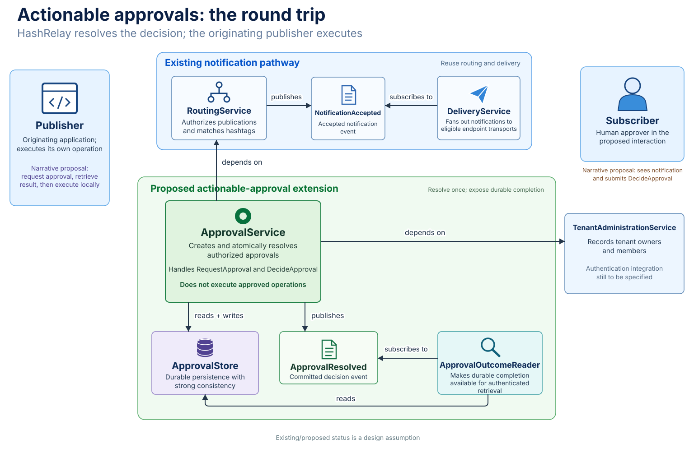
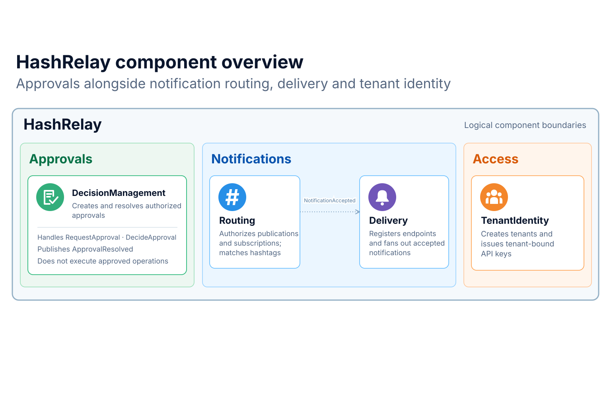

# Actionable approvals — implementation contract

Status: **Development-ready design proposal, not implementation.** Date: 2026-11-01.
Source architecture: `architecture/model/hash-relay.adl` (Continuum ADL 1.4 draft; compile attestation `sha256:44127a98aa3fa1f667c2f57ef2ac9e3a5c4664b703aac6f73c3cecad4e4d56ea`). Compiler result: 0 errors / 15 warnings; approval-specific warnings include unverified DecisionIntegrity and missing BC ownership; ApprovalResolved now has a declared subscriber. Acceptance and implementation verification remain separate gates.

## Bounded-context responsibility
`Approvals.DecisionManagement.ApprovalService` owns approval state, authorized transitions and durable result publication. `ApprovalStore` is the authoritative transactional store. Existing `Notifications.Routing` publishes an ordinary notification referencing an approval, and `Notifications.Delivery` transports it with the existing at-most-once logical endpoint fanout. `Access.TenantIdentity` supplies verified tenant and human identity. Requesting systems execute their own actions after reading/validating the decision. A toast, webhook, SignalR event or MCP response is not the decision source of truth.

## Model and persistence
Persist `Approval`: `id UUID`, `tenantId`, `requesterCredentialId`, `requesterCorrelationId`, `subject`, `description` (text, untrusted), `targetUserIds` (nonempty normalized stable tenant-member IDs), `status`, `createdAt`, `expiresAt`, `decidedAt`, `decidedByUserId`, `decisionNote`, `version`, `notificationId` nullable. Use existing secure authenticated tenant context; do not trust caller-supplied tenant or actor IDs. Store a normalized request payload hash for idempotency. Add unique `(tenantId, requesterCredentialId, idempotencyKey)`. Store `ApprovalAudit` immutable entries recording creation, notifications, decision, expiry, cancellation, actor, correlation and request IDs (without tokens or sensitive message bodies). Add a durable completion/outbox record keyed by approval ID and transition version to publish `approval.resolved` after commit; consumers deduplicate.

Terminal states: `Approved`, `Rejected`, `Expired`, `Cancelled`; initial `Pending`. Only `Pending` transitions to terminal. Time of decision must satisfy `serverNow < expiresAt`. Expiry may be materialized lazily on every read/decide plus a background sweep; the database condition is definitive. Decision CAS: update with `WHERE tenantId = ? AND id = ? AND status = Pending AND expiresAt > serverNow` under transaction, insert audit and outbox atomically. Losing contender returns current state with conflict response; never reverts state. Exact retries with the same decision idempotency key return prior outcome. Requester cancellation requires original requester credential identity or expressly authorized admin; no cancellation of terminal request.

### Authentication and permissions
Request: authenticated publisher credential carrying `approvals:create` (service account), or equivalent explicitly granted publish-side authority; authorization bounded to tenant. Reject unsafe creation using a subscriber-only device token. Resolve each designated approver to a tenant member server-side; no cross-tenant identities. Decision: authenticated interactive human account/session with `approvals:decide` and member identity in the request's target set. **Device pairing alone and publish credentials alone must never approve**. For an agent/desktop/mobile button, open a first-party HTTPS decision page authenticated as that human, unless a secure existing interactive identity flow supports equivalent authorization. Protect browser decision POST with CSRF mitigations and SameSite policy; rate limit endpoints; do not treat bearer tokens in URLs as authorization. Recheck account membership and request eligibility at decision time. No global admin bypass in v1. Display publisher provenance from verified credentials where possible, otherwise Unknown; do not classify MCP callers as agents.

## HTTP API v1 extensions (proposed)
Existing `/api/v1/notifications` remains unchanged.
- `POST /api/v1/approvals` — create with `Idempotency-Key`, `subject`, optional `description`, `targetUserIds`, `expiresAt`, `tags` (optional routing tags), `requesterCorrelationId` (optional). Server derives tenant/requester. Return `201 Created` + resource or `200` same-key replay; mismatched same-key payload returns `409`. Must not trigger duplicate notification on replay.
- `GET /api/v1/approvals/{id}` — tenant-scoped resource; authorized original requester (or designated approver) only. Return status, version, timestamps, decision actor where entitled, and `notificationId`.
- `GET /api/v1/approvals?status=&limit=&cursor=` — only requests actor may view; bounded pagination and tenant filtering.
- `POST /api/v1/approvals/{id}/decision` — body `{ "decision": "approve" | "reject", "note": "optional" }`, plus `Idempotency-Key`; interactive human only. On success `200` state; concurrent conflicting decision `409` with current state; expired `409` with `Expired`; invalid decision `400`; unauthorized `403`; invisible or foreign tenant `404`.
- `POST /api/v1/approvals/{id}/cancel` — requester-authenticated, idempotent until terminal; `200` current record or `409` if already decided. Expiry takes precedence when past expiry.

Error responses use existing API error envelope. No implicit approval on GET, toast click, notification acknowledgement or device delivery. Use server-generated immutable approval IDs; no arbitrary action URL supplied by publisher. If approved, requester must independently validate business preconditions before executing.

## MCP surface
Add `request_approval` and `get_approval` with tenant/scope enforcement and untrusted-content notices. Add `list_approvals` only if existing read policy allows actor-filtered visibility. **Do not expose `approve_approval` or `reject_approval` to non-human MCP service credentials in v1.** Tool descriptions must not imply that submission waits for approval or execution. Tools return IDs/status and authoritative detail URL. Preserve `publish_notification` contract and existing MCP features.

## Client experience
Notification link opens `/approvals/{id}` on HashRelay's own origin. Detail view shows verified requester (or Unknown), action, expiry, full request details and current status. Approved/rejected buttons submit authenticated POST after displaying the operation, particularly high-risk actions. Confirm success from the server before reporting completion. All other devices refresh final state; stale notifications cannot reverse it. Offline catch-up can summarize requests but must prominently surface still-pending approvals, never turn historical terminal requests into active action buttons. No Windows toast executable command or untrusted external URL is an authorization mechanism. Screen readers, keyboard navigation and small screens must work.

## Result delivery and liveness
Use transactional outbox and a bounded retry dispatcher. Provide an authenticated GET for any requester that misses callbacks, and optional `approval.resolved` event published after commit (with approval ID/status/version/correlation, not full sensitive detail). Never infer approval from notification receipt/ack. Sweep expired Pending approvals and emit one terminal event. If an outbox consumer crashes, retry idempotently. Use existing service infrastructure if adequate rather than adding a queue product.

## Acceptance scenarios (release blocking)
1. Create for a valid target in tenant A; one notification routes through existing tag/endpoint mechanisms, one persistent Pending approval exists.
2. Same idempotency key and same payload returns one request; differing payload conflicts.
3. Authorized human approves; state, audit, outbox commit together; requester GET reads Approved and can resume its own process.
4. Reject path records Rejected and prevents requester treating it as approval.
5. Two devices decide concurrently; exactly one wins and all later reads show the winner.
6. Expired approval cannot be decided, including at the expiry boundary; sweep and lazy handling converge.
7. Requester cancels Pending; further approve/reject fails; no post-cancellation execution implied.
8. Cross-tenant request/read/decide and service-account-only decision are denied without leaking record existence.
9. Unlisted tenant member, expired account session and revoked tenant membership cannot decide.
10. WebSocket disconnect/outbox retry does not lose committed decision or duplicate its state transition.
11. An approval presented to several devices remains one approval; duplicate tags do not duplicate logical deliveries.
12. Notification delivery/display/ack is independent of approval state; old toast only opens current detail.
13. Existing non-actionable REST/MCP notifications and clients continue functioning unchanged.
14. Audit identifies verified decision actor/time/requester without leaking credentials.
15. Mobile/desktop toast action requiring user auth opens first-party confirmation, cannot approve from a device key or forged deep link.

## Development sequence
1. Migration and domain service with atomic transitions, authorization and unit/integration tests.
2. HTTP resources and tenant-filtered query policies.
3. Outbox/event + requester read/recovery.
4. Server-side actionable notification rendering and authenticated web confirmation.
5. MCP creation/read tools and client integrations.
6. End-to-end Windows/mobile multi-device tests, regression, migration/rollback review and deployment.

## Explicit deferrals
Multi-person quorum, delegation, hierarchical policies, escalation, approval execution, scheduling, custom approval buttons, external action URLs and third-party callback registration. Notification backlog UX is a separate concern; don't expand this change into general delivery redesign.

## Remaining implementation gates
ADL is an unaccepted draft; review/adopt against repo lifecycle rules. Continuum warnings must be evaluated (not silently ignored), particularly the approval event consumer, verification and ownership bindings. Validate schema against existing database migrations, identity policies and deployment conventions before implementation. No code/tests were executed by this design-only artifact.

## Approval round trip — who records and returns the decision



This revised **Continuum Diagram**, generated from the evolved ADL, shows ApprovalService, existing RoutingService/DeliveryService, durable ApprovalStore, ApprovalResolved and ApprovalOutcomeReader. The actual human-to-service and originating publisher-to-service paths remain labeled narrative proposals because ADL does not declare them. The detailed sequence below specifies those proposed interactions.

This sequence is the **proposed implementation contract** grounded in the Continuum model. The model now declares ApprovalService's dependency on RoutingService and TenantAdministrationService and declares ApprovalOutcomeReader subscribing to ApprovalResolved. The concrete HTTPS calls, transactional outbox and originating-system polling are implementation choices documented here, **not falsely claimed to be executable ADL workflow semantics**.

```mermaid
sequenceDiagram
    autonumber
    participant Origin as Originating system
    participant Approval as ApprovalService
    participant Store as ApprovalStore + Outbox
    participant Routing as Existing RoutingService
    participant Delivery as Existing DeliveryService
    actor Human as End user
    participant Reader as ApprovalOutcomeReader

    Origin->>Approval: POST /approvals (idempotency key, approver, expiry, correlationId)
    Approval->>Approval: Validate tenant, requester and designated approver
    Approval->>Store: Commit Pending approval + audit + notification intent
    Store-->>Approval: approvalId
    Approval-->>Origin: 201 Pending (approvalId; status URL)
    Approval->>Routing: Publish linked notification to hashtags
    Routing-->>Delivery: NotificationAccepted
    Delivery-->>Human: Native toast / mobile push (approvalId link)
    Human->>Approval: Open first-party approval page (authenticated)
    Approval->>Store: Read current state and approver entitlement
    Store-->>Approval: Pending, version, expiry
    Approval-->>Human: Show details and Approve / Reject
    Human->>Approval: POST /approvals/{id}/decision (approve or reject)
    Approval->>Approval: Recheck human identity, eligibility and expiry
    Approval->>Store: Atomic Pending -> Approved/Rejected + audit + outbox
    alt First valid decision wins
        Store-->>Approval: Committed terminal state
        Approval-->>Human: Decision confirmed
        Store-->>Reader: ApprovalResolved (via durable outbox)
        Reader-->>Origin: Result available / event hint
        Origin->>Approval: GET /approvals/{id}
        Approval->>Store: Read authoritative terminal state
        Store-->>Origin: Approved/Rejected + actor + time + correlationId
        Note over Origin: Revalidate business preconditions; execute only when Approved
    else Already terminal or expired
        Store-->>Approval: Conflict / final state
        Approval-->>Human: Existing decision / expired; no new transition
    end
```

**Where the decision lives:** ApprovalStore is the server's transactional source of truth; the decision row, immutable audit entry, and outbox event are committed atomically. SignalR and push deliver *information*, not authoritative state. If the client disconnects after clicking Approve, it can re-read status; the server cannot undo a committed decision merely because its response was lost.

**How the originating system learns:** It stores `approvalId` and `requesterCorrelationId` returned by creation. It can poll the authenticated GET status endpoint at any time, or wake up on an at-least-once `ApprovalResolved` event and then GET. An offline requester can recover without a persistent socket; duplicated events are deduplicated by approval ID and state version. `ApprovalOutcomeReader` is modeled as an internal completion subscriber, **not as a guaranteed external webhook**. Do not suggest that directly pushing events to arbitrary systems already exists. 

**What approval authorizes:** It is a durable human decision, not an executable delegation to HashRelay. The originating system still validates authorization scope, original request identity, target release/environment, and current business preconditions before doing anything.

**Example:** A deployment service requests approval for release v2.4.1 and receives `approvalId=123`. Your Windows device displays the request. You open the authenticated decision page and approve. HashRelay records `Approved` plus the actor/time and emits a durable completion notification. The deployment service sees that completion, GETs approval 123, confirms it still matches release v2.4.1, and runs the deployment using its own credentials. If the requester was offline, it retrieves that same Approved state on restart.

**Model fidelity:** Continuum Diagram generated a revised round-trip editorial view from ADL attestation `sha256:44127a98aa3fa1f667c2f57ef2ac9e3a5c4664b703aac6f73c3cecad4e4d56ea` (run `7c89f31a-b716-473b-bd7c-de40a9854e24`). It reports that no formal Workflow elements exist, so the sequence above is explicitly a proposed contract, not an ADL-validated runtime trace.

## Continuum Diagram — approval architecture in context



Generated with Continuum Diagram from the draft ADL at attestation `sha256:44127a98aa3fa1f667c2f57ef2ac9e3a5c4664b703aac6f73c3cecad4e4d56ea` (run `ecfbf24c-2999-4a86-9a06-5bd8bb36def5`). The reconstructed editable SVG passed geometric, semantic fidelity, and containment checks. It is **not** a claim that the draft architecture is accepted or its proposed cross-context integrations already implemented. The Routing-to-Delivery route is deliberately drawn with a weaker dotted grade by the renderer, although Routing publishes and Delivery subscribes to `NotificationAccepted` in the ADL.

### Existing behavior versus proposed approval behavior

| Concern | Existing HashRelay | Actionable approval enhancement |
| --- | --- | --- |
| Submission | An authorized publisher sends a notification to `POST /api/v1/notifications` or MCP `publish_notification` | Authorized requester creates a separate `Approval` resource and an ordinary linked notification is issued |
| Routing | `RoutingService` authorizes workspace/tag matching and emits `NotificationAccepted` | Reuse RoutingService for attention/hashtag addressing; it does not own approval state |
| Delivery | `DeliveryService` fans out to eligible endpoints by realtime/FCM and records delivery status | Multiple endpoint presentations refer to **one approval ID**, never separate approvals |
| Identity | Tenant and credential scopes already gate publishing and subscriptions | Existing tenant isolation is reused, but a real authenticated human's approver entitlement must also be checked |
| Action | Notification may carry informational URL and can be acknowledged | Open a first-party authenticated detail page; Approve/Reject sends a decision command, not an acknowledgement |
| Durable authority | Notification, subscription, delivery and endpoint persistence | `ApprovalStore` is the sole authority for Pending/Approved/Rejected/Expired/Cancelled; delivery status never changes approval state |
| Completion | A notification can be read or acknowledged | `ApprovalResolved` and requester GET expose the terminal result; requester independently executes authorized business work |

### Walkthrough: deployment requires approval

1. A deployment publisher authenticates using its workspace-bound credential and calls `POST /api/v1/approvals`. `ApprovalService` verifies allowed approvers, writes **Pending** and a durable audit record, and associates the approval ID with a notification.
2. Existing `RoutingService` receives the publication, matches its hashtags and emits `NotificationAccepted`. `DeliveryService` routes the normal notification to subscribed Windows/mobile endpoints. **Neither delivery nor toast presentation decides anything.**
3. The user opens the linked HashRelay approval page. The page authenticates the interactive user and retrieves current approval status, verifies actor eligibility, and displays details and expiry. Clicking Approve POSTs `DecideApproval` to `ApprovalService`; clicking a stale Windows toast cannot bypass this check.
4. `ApprovalService` atomically changes Pending to Approved, records actor/time/audit and a durable completion outbox entry. A competing Reject on another device loses, reads final state and cannot reverse it.
5. The requester eventually receives `ApprovalResolved` or retrieves the authoritative result through GET, validates its own preconditions and performs its deployment. HashRelay never performs that deployment.
6. If the device is offline, the notification can be synchronized later but the approval remains governed by its own expiry and final status. A late toast opens the current status; it does not offer a still-active button for an expired/resolved request.

### Architecture relationships still needing explicit declaration

The updated ADL **declares** `RoutingService publishes NotificationAccepted`, `DeliveryService subscribesTo NotificationAccepted`, `ApprovalService publishes ApprovalResolved`, `ApprovalOutcomeReader subscribesTo ApprovalResolved`, plus ApprovalService dependencies on RoutingService and TenantAdministrationService. It does **not** declare a complete execution workflow, concrete end-user interaction calls, the exact notification publication protocol, or the initiating publisher's authenticated retrieval path. Those are explicit implementation contracts above rather than fictional declared edges. The model compiles with zero errors and 12 warnings; review remaining ownership and verification obligations before architecture acceptance.


> **Integration note (2026-11-01):** The current architecture was generated by applying `architecture/changes/2026-11-01-actionable-approvals.adl-change` to the catch-up/attribution baseline using Continuum. Applied state and recompiled emitted state both equal `sha256:44127a98aa3fa1f667c2f57ef2ac9e3a5c4664b703aac6f73c3cecad4e4d56ea`. Existing diagrams were produced from the preceding approvals-only draft and are explanatory references, **not renderings of this new integrated attestation**. Review the 15 design warnings before ratifying the architecture.
