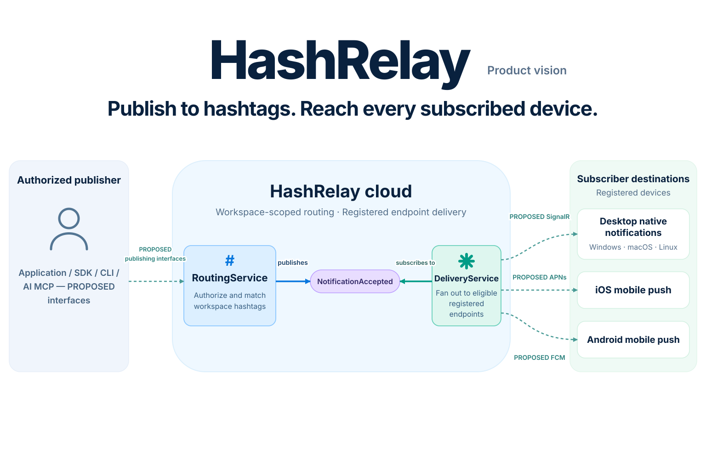
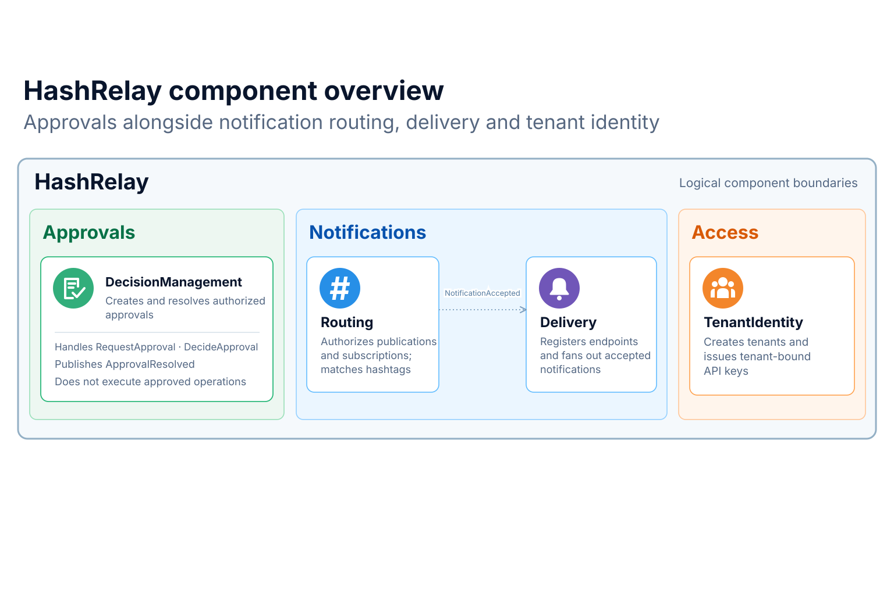

# HashRelay — product vision (draft)

HashRelay is a workspace-scoped hashtag-based notification platform. Authorized applications, CLIs and AI agents publish a notification with one or more tags; subscribed users receive it through registered desktop or mobile application endpoints.

## Product surfaces
- HashRelay Cloud: public HTTPS API, subscription and endpoint management, routing and delivery.
- HashRelay Agent: installable native notification endpoint for Windows, macOS and Linux, with per-user startup and CLI.
- Mobile SDKs: native iOS/Android and later wrappers, using the integrating app's APNs/FCM credentials and identity.
- HashRelay App: optional first-party mobile subscriber app.
- MCP server: agent-facing publish and subscription capabilities, with scoped authorization.
- Developer SDK: application-facing publish and subscription operations.

## Principles
- A hashtag names a subscription topic within a workspace, not a globally public broadcast channel.
- A publication matching several tags produces one logical notification per eligible endpoint.
- Persistence and subscriptions belong to HashRelay, not SignalR groups.
- Delivery transports are adapters: SignalR for connected desktop clients; APNs/FCM for mobile push. Foreground mobile clients may use SignalR.
- Never equate provider acceptance with display or user acknowledgement.
- Authorization, quotas, and isolation must exist before permitting untrusted external publishers.

## Initial proof of value
One Windows user installs the agent, subscribes to #builds, and receives a native notification published through the cloud API or CLI. Subscriptions survive restart/reconnection. An unrelated workspace cannot publish into that subscription.

## Deliberate exclusions from first milestone
Mobile push, marketplace-ready packaging, extensive multi-tenant administration, web dashboard, MCP tooling, rich notification actions, and scale-out are later increments.

## Multi-tenant developer experience
Users sign up, select or create a tenant workspace, and access a developer dashboard to issue tenant-scoped API credentials. Tags are meaningful only inside the authenticated tenant. Trusted integrations publish using tenant-bound credentials; users and devices subscribe through individually authorized identities.

## Continuum Diagram — product vision

This is a checked Continuum Diagram rendering of the earlier pinned ADL architecture (attestation `sha256:f2ce446b35e77d5a7aae1bed4715ac80f0f61e4fd6b9fd75d0cf7c78047012dd`). It illustrates the product ambition, including future mobile endpoints; dotted paths are planned rather than established ADL relationships. The current Windows-first ADL has since evolved; the image must not be treated as the current model's canonical projection.

## Planned enhancement — Actionable approvals (2026-11-01)

**Status:** development-ready proposal; not yet implemented or accepted as authoritative architecture.
**Detailed implementation contract:** [Actionable approvals](ACTIONABLE-APPROVALS.md).
**Continuum draft:** [architecture/model/hash-relay.adl](../architecture/model/hash-relay.adl), compiled using adl/1.4, attestation `sha256:260afc5be54aeddcadaad953d6b08256efdc63f167434104b0f1e317ae84ad8a`.

### Vision
A publisher may request a human decision and address it to an authorized approver. HashRelay persistently tracks one approval request independently of its notification deliveries; a subscriber can approve or reject through an authenticated client. The original publisher can reliably observe the terminal result and decide what to execute. This is useful for automated services and human workflows as well as AI agents; MCP is a transport, not evidence that a publisher is an agent.

### Product principles
- A notification attracts attention; an approval is a distinct durable, tenant-scoped resource and decision lifecycle.
- Displaying, clicking or dismissing a toast is **not** approval; server authorization and an atomic state transition are required.
- One approval can reach several endpoints; the first valid terminal decision wins. Subsequent clients see final state, never competing outcomes.
- No unauthenticated, device-only, or publisher API-key-only decision is permitted. Verify the human subject and approver eligibility on the server.
- Approval does not execute the requested operation or confer the requester's permissions on HashRelay.
- Decisions are retrievable even when notifications, websocket connections or callbacks fail; published result notifications are at-least-once hints.
- Requests expire, may be cancelled by authorized requesters, and cannot be approved afterwards.
- Desktop and mobile clients show current state; high-impact approvals open an authenticated confirmation view instead of committing with one unreviewed toast click.
- The feature builds on existing tenant identity, service-account policies, notification routing, endpoints, HTTP, and MCP; no new transport or generalized workflow engine.

### Initial scope
Create/list/read approval requests; authorized approve/reject; expiry/cancellation; stable correlation; detail-page and notification presentation; durable requester retrieval and resumable completion indication; audit trail; REST + MCP creation and status; multi-device convergence. Future extensions (quorum voting, delegation, automatic execution, conditional approval policies, complex escalation chains) are explicitly out of scope.

### Actionable approval architecture diagram

This is a Continuum Diagram C3 view from the proposed ADL, not a diagram of implemented approval functionality. See [Actionable approvals](ACTIONABLE-APPROVALS.md#continuum-diagram--approval-architecture-in-context) for the detailed state flow and gaps still to be declared.
