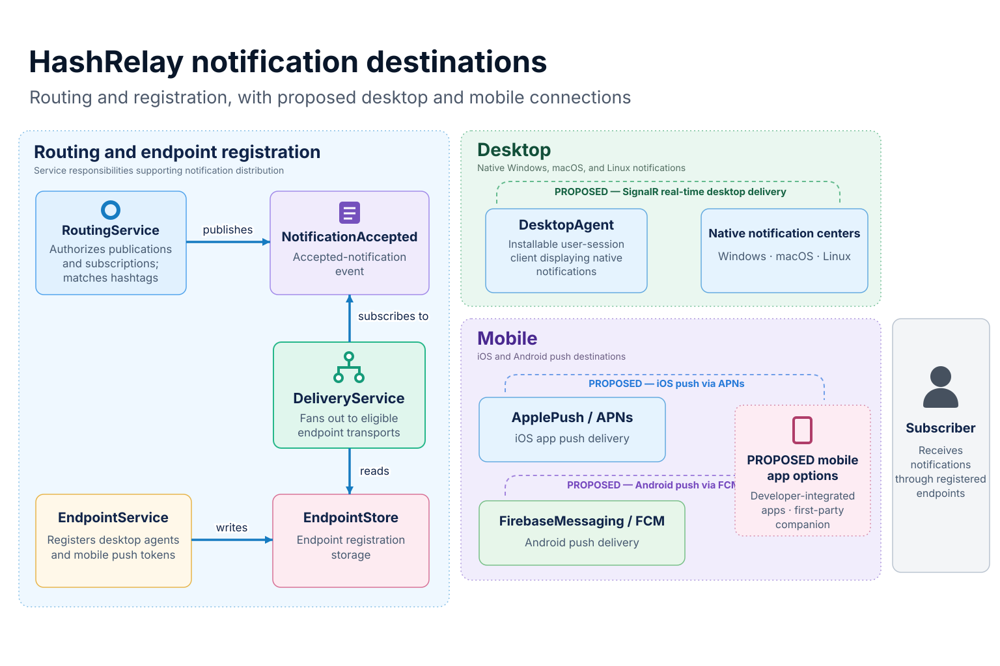

# Windows-first development handoff

## Goal
A developer installs HashRelay on Windows, runs a CLI publishing command, and observes a native notification in Windows Notification Center via **ASP.NET Core SignalR**.

## Milestone M1A — local, end-to-end SignalR demonstration
Run one ASP.NET Core .NET 10 server locally; start the Windows per-user agent, have it connect via authenticated SignalR to the server and subscribe to `#demo`; use the CLI to POST a publication; the server relays it over SignalR; the agent displays a native Windows notification. This milestone intentionally does **not** implement the SaaS dashboard or hosted multi-tenant registration. Development credentials must not be shipped as production secrets.

## M1A components
- `HashRelay.Server`: .NET 10 ASP.NET Core Web API, SignalR hub, single in-memory/demo tenant, HTTP publish endpoint and health endpoint.
- `HashRelay.Windows`: .NET 10 Windows app SDK integration, foreground/interactive agent, auto-reconnect, subscription registration, native Windows App SDK AppNotifications; must run in user session.
- `hash-relay` CLI: `listen #demo`, `publish #demo "Title" "Body"`, `test`, `status`; published messages travel via HTTP to server and SignalR to listener, not direct local toast.
- Windows installer: per-user installation, install and start the agent, register per-user auto-start, clean uninstall; installer must package all runtime dependencies, and must not require admin for per-user install.
- SDK: .NET client SDK consumes public publish API, with future native transport adapters separate from publisher concerns.

## Following milestone M1B — tenant SaaS
Web signup/signin, workspace creation, API key generation/revocation, tenant-qualified subscriptions, authorization on HTTP and SignalR, durable subscription/endpoint store and access audit. Public client agents do **not** embed trusted tenant publisher API keys; choose subscriber enrollment protocol explicitly.

## Acceptance scenarios
1. Clean Windows install succeeds and registers a startup agent; the agent appears as a notification sender to Windows.
2. Start server; run `hash-relay listen #demo`; run `hash-relay publish #demo "Build complete" "The build passed"` from a separate process; native toast appears and remains available in the Windows notification center subject to OS settings.
3. Publishing to an unsubscribed tag does not display a notification.
4. Multiple matching tags yield at most one logical notification per endpoint.
5. A disconnected listener reconnects and restores subscriptions; restart behavior is explicit.
6. Wrong credentials reject publishing and listening; no tenant boundary can be inferred from a client-provided ID alone.
7. Installer supports removal, and disables the per-user autostart entry.
8. The .NET SDK integration sample publishes through the same HTTP contract as the CLI.

## Design rules
- Use SignalR as connected delivery transport; don't use SignalR groups as persistent subscription authority.
- Keep tenant IDs on all domain records, but remote tenant isolation is M1B, not a claim proven by the local loopback demo.
- Do not host a background Windows notification agent as a Windows service; notifications need interactive user context.
- Demonstrate real network delivery before introducing a broker, multiple microservices or Azure infrastructure.

## Handoff status
ADL and BDL compile successfully; technology bindings are authored as an **unvalidated proposal** until the target binding vocabulary/schema is registered and verified. The source code, installer, and an actual Windows end-to-end run still need to be implemented/tested. No successful installation or notification delivery is claimed by this documentation.

## Continuum Diagram — notification delivery landscape

This illustration shows declared routing/delivery concepts and proposals for desktop SignalR and mobile push transports. It comes from an earlier ADL snapshot (attestation `sha256:f2ce446b35e77d5a7aae1bed4715ac80f0f61e4fd6b9fd75d0cf7c78047012dd`), not the latest Windows-first ADL. **Only the Windows/SignalR path is in M1.** Neither the Windows executable nor the installer is yet implemented merely by including this diagram.

## Development-authoritative contract

Before coding, follow [Windows M1 contract](WINDOWS-M1-CONTRACT.md) and [ADR-0001](adr/0001-windows-first.md). They resolve the earlier unchosen endpoint authentication and installer/transport behavior. M1A is **local loopback**; the Terraform infrastructure is for **M1B only**. In a conflict with examples above, the Windows M1 contract governs implementation details; ADL/BDL govern semantic architecture. Real Windows verification remains a release gate.
